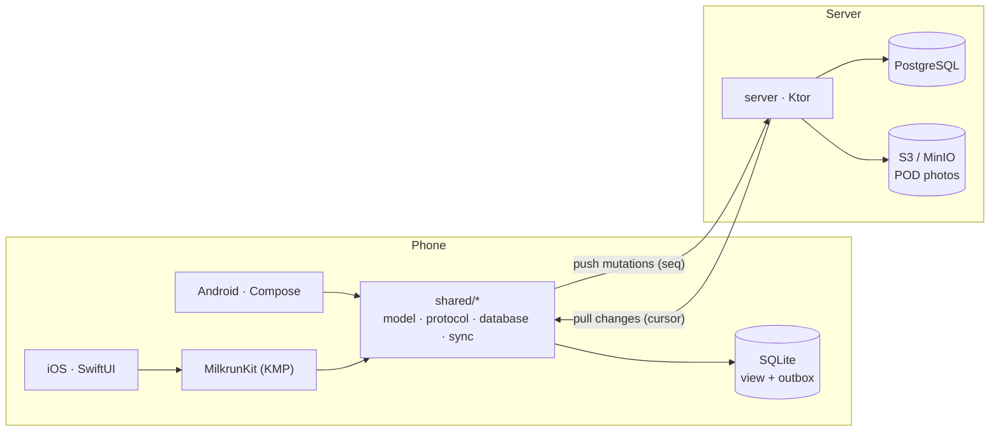

**English** | [中文](README.zh.md)

# Milkrun

**An offline-first platform for last-mile delivery drivers.** Kotlin Multiplatform core shared by a
SwiftUI iOS app and a Jetpack Compose Android app, synced through a Kotlin (Ktor) service.

A *milk run* is a fixed delivery route with many stops. Drivers run it in basements, lifts and rural
roads where the network comes and goes; Milkrun is built so that the app never loses a delivery and
never records one twice, whatever the network does.



## What makes it interesting

- **One sync engine for both apps.** Outbox written in the same SQLite transaction as the optimistic
  update; push deduplicated by per-client sequence; cursor-based pull; pending mutations rebased on
  server state ([ADR 0002](docs/adr/0002-sync-protocol.md)).
- **Server-arbitrated conflicts.** The stop state machine lives in `shared/model` and is compiled
  into the phone *and* the server, so both sides apply the same rules.
- **Deterministic simulation tests.** Seeded shifts with two devices per route, a dispatcher, lost
  requests and responses, stale duplicates, dead zones and app restarts. Latest run: 1,000 seeds,
  66,753 mutations, 10,910 lost responses, 4,000 restarts, **0 invariant violations**; injected
  protocol bugs are caught in 200/200 runs ([chapter 01](docs/illustrated/01-offline-delivery.md#6--one-trace-is-an-anecdote-66753-mutations-through-seeded-chaos)).
- **Industrial build.** Gradle convention plugins, version catalog, `explicitApi()`, warnings as
  errors, ktlint, CI on Linux (JVM + Android) and macOS (iOS simulator).

## Repository layout

| Path | What |
|---|---|
| `build-logic/` | Gradle convention plugins (`milkrun.kmp.library`, `milkrun.jvm.service`) |
| `shared/` | Kotlin Multiplatform modules (Android, iOS, JVM targets) |
| `server/core` | Authoritative sync service (push/pull/dispatch) over a storage interface |
| `server/app` | Ktor service on PostgreSQL (M2) |
| `android/` | Compose app |
| `ios/` | SwiftUI app (XcodeGen) |
| `tools/simulation` | Deterministic sync simulator and the trace that feeds the illustrated docs |
| `docs/illustrated/` | One parcel followed through the system, with real data |
| `docs/adr/` | Architecture decision records |

## Status

| Milestone | Scope | State |
|---|---|---|
| M0 | Skeleton, toolchain, CI, ADRs | done |
| M1 | Shared core: model, state machine, HLC, SQLDelight, sync engine, simulation tests | done |
| M2 | Server: auth, push/pull, Postgres, dispatch, route optimisation | next |
| M3 | Android app | |
| M4 | iOS app | |
| M5 | Proof-of-delivery photo upload, location, geofencing | |
| M6 | Observability and security | |
| M7 | Load and chaos testing | |

## Build

Requirements: JDK 21 (Amazon Corretto), Android SDK (API 37), Xcode 26 for iOS.

```bash
./gradlew jvmTest                 # shared modules on the JVM (fastest)
./gradlew testAndroidHostTest     # shared modules on the Android host
./gradlew iosSimulatorArm64Test   # shared modules on the iOS simulator (macOS)
./gradlew test                    # server core + simulation (300 seeds, fault injection)
./gradlew spotlessCheck           # ktlint
./gradlew :tools:simulation:trace # regenerate the data in docs/illustrated/01
```
