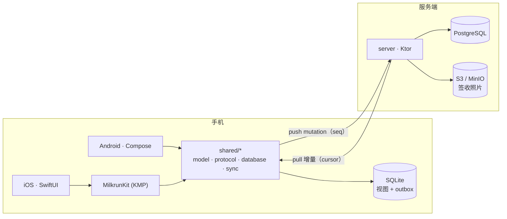
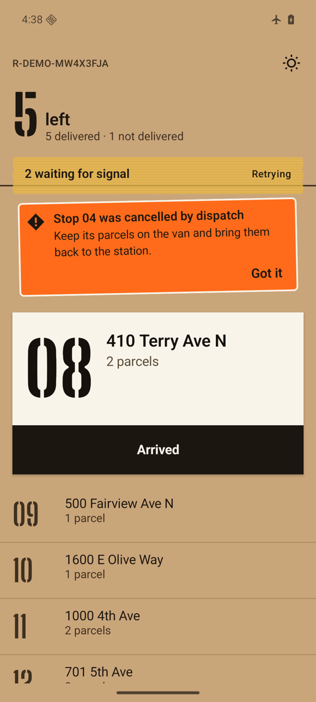
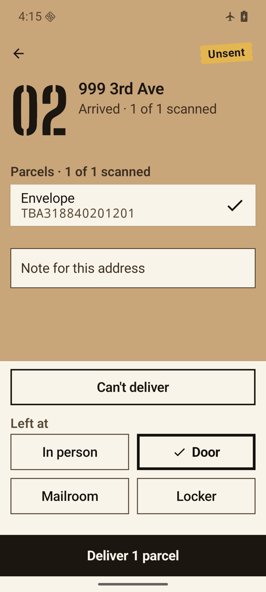
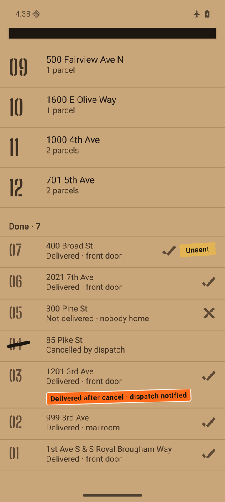
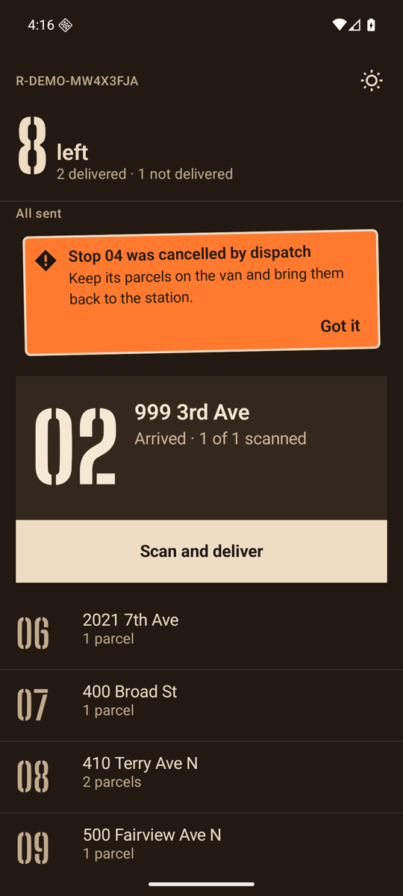

[English](README.md) | **中文**

# Milkrun

**面向末端配送司机的离线优先平台。** Kotlin Multiplatform 共享核心，同时供 SwiftUI iOS App 和
Jetpack Compose Android App 使用，通过 Kotlin（Ktor）服务端同步。

*milk run* 指一条固定的多站点配送线路。司机在地下车库、电梯、乡村道路上跑这条线，网络时有时无；
Milkrun 的目标是：无论网络怎样，App 既不丢一次送达，也不重复记一次送达。



## 亮点

- **两个 App 共用一套同步引擎。** outbox 与乐观更新写在同一个 SQLite 事务里；push 按每个客户端的
  序号去重；pull 基于游标；未确认的 mutation 在服务端状态上 rebase（见 [ADR 0002](docs/adr/0002-sync-protocol.md)）。
- **服务端裁决冲突。** 站点状态机放在 `shared/model`，同一份代码同时编译进手机和服务端，两边规则一致。
- **确定性仿真测试。** 用固定种子模拟一个班次：每条线路两台设备、调度员改单、请求和响应丢失、
  过期重复、信号死区、App 被杀重启。最近一次：1,000 个种子、66,753 次 mutation、10,910 次响应丢失、
  4,000 次重启，**0 次违反不变量**；注入的协议 bug 在 200/200 次运行里都被抓到（见[图解 01](docs/illustrated/01-offline-delivery.md)）。
- **服务端定序。** 每次写入都锁住所在线路的行，所以每条线路的版本号是没有空洞的 pull 游标。
  同一套存储契约测试同时跑在内存实现和 PostgreSQL 17 上，混沌仿真也在 PostgreSQL 上跑：200 个种子，0 违反（见[图解 02](docs/illustrated/02-server-side.md)）。
- **用打包间自己的记号画界面。** 牛皮纸上的模板喷印站号，半透明封箱胶带表示「等信号」，橙色异常贴纸
  表示服务端的裁决；牛皮纸 / 夜间 / 强光三套配色，主要操作 56–64 dp，戴手套也能按。设计系统见
  [design/DESIGN.md](design/DESIGN.md)，模拟器截图见[图解 03](docs/illustrated/03-android-stop.md)。

<p>




</p>

- **工业级工程化。** Gradle convention plugins、version catalog、`explicitApi()`、警告即错误、ktlint，
  CI 分 Linux（JVM + Android）和 macOS（iOS 模拟器）两路。

## 目录

| 路径 | 内容 |
|---|---|
| `build-logic/` | Gradle convention plugins（`milkrun.kmp.library`、`milkrun.jvm.service`） |
| `shared/` | Kotlin Multiplatform 模块（Android、iOS、JVM 三个 target） |
| `server/core` | 权威同步服务（push/pull/调度），基于存储接口 |
| `server/app` | Ktor 服务：JWT、push/pull、调度与路线规划、PostgreSQL（Flyway、JDBC）、指标、Dockerfile |
| `android/app` | Compose App：Material 3 主题化为打包间风格、WorkManager 后台同步、Roborazzi 截图黄金图 |
| `shared/presentation` | 两个 App 共用的页面状态和司机文案 |
| `design/` | DESIGN.md、模板字体（OFL） |
| `ios/` | SwiftUI App（XcodeGen） |
| `tools/simulation` | 确定性同步仿真器，以及为图解文档生成数据的 trace |
| `docs/illustrated/` | 跟着一个包裹走完整个系统（图解，真实数据） |
| `docs/adr/` | 架构决策记录 |

## 进度

| 里程碑 | 范围 | 状态 |
|---|---|---|
| M0 | 骨架、工具链、CI、ADR | 完成 |
| M1 | 共享核心：模型、状态机、HLC、SQLDelight、同步引擎、仿真测试 | 完成 |
| M2 | 服务端：鉴权、push/pull、Postgres、调度、路线优化 | 完成 |
| M3 | Android App | 完成 |
| M4 | iOS App | 下一步 |
| M5 | 签收照片上传、定位、地理围栏 | |
| M6 | 可观测性与安全 | |
| M7 | 压测与混沌测试 | |

## 构建

需要 JDK 21（Amazon Corretto）、Android SDK（API 37），iOS 需要 Xcode 26。

```bash
./gradlew jvmTest                 # 在 JVM 上跑共享模块测试（最快）
./gradlew testAndroidHostTest     # 在 Android host 上跑
./gradlew iosSimulatorArm64Test   # 在 iOS 模拟器上跑（macOS）
./gradlew test                    # 服务端（Testcontainers Postgres）+ 仿真（300 个种子 + 故障注入）
docker compose up --build         # Postgres + 同步服务，端口 8080（先 ./gradlew :server:app:buildFatJar）
./gradlew spotlessCheck           # ktlint
./gradlew :tools:simulation:trace # 重新生成图解 01 里的数据
```
