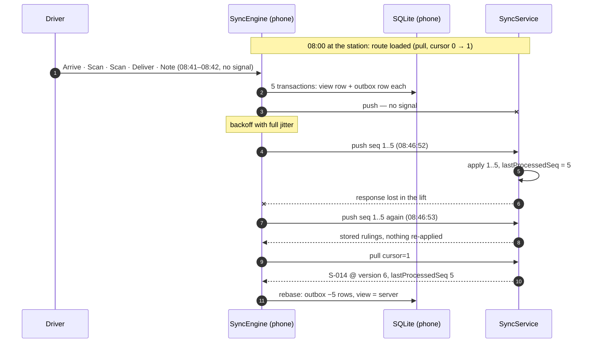

# 01 · A delivery made offline: from tap to outbox row

> Everything below (JSON bodies, SQLite rows, HLC values, backoff sleeps) was produced by
> `./gradlew :tools:simulation:trace`, which drives the real `SyncEngine` against the real
> `SyncService` on a virtual clock. The SQLite files it snapshots are in
> `tools/simulation/build/trace/*.db`; the tables below are `sqlite3 -header -column` output from
> them. Long JSON is abridged where marked `…`; nothing else is edited.

## The scene

Route `R-2026-11-06-DSE4-017`, 08:41 PST. The driver parks in the basement garage under
**410 Terry Ave N** (stop `S-014`, two parcels) and loses signal. Over the next two minutes they
tap *Arrived*, scan both labels, mark the stop *Delivered – front door* and add a note. Then they
take the lift back up, and the lift doors cut off the first response from the server.



## 1 · What the phone holds before the garage

At the station the app pulls the whole route (`cursor=0`). The server answers with every stop and
the route's version, which becomes the pull cursor:

```
GET /v1/routes/R-2026-11-06-DSE4-017/pull?client=q7m2x9ka&cursor=0
200 OK
{
    "cursor": 1,
    "lastProcessedSeq": 0,
    "changes": [
        { "id": "S-013", … "status": "planned" },
        {
            "id": "S-014",
            "routeId": "R-2026-11-06-DSE4-017",
            "sequence": 14,
            "address": "410 Terry Ave N, Seattle, WA 98109",
            "location": { "lat": 47.6223, "lng": -122.3365 },
            "parcels": [
                { "id": "TBA318840275001", "description": "medium box",    "scanned": false, "delivered": false },
                { "id": "TBA318840275002", "description": "padded mailer", "scanned": false, "delivered": false }
            ],
            "status": "planned",
            "note": "",
            "noteHlc": "0000000000000000-0000-0"
        }
    ],
    …
}
```

Each snapshot lands twice on the phone:

| table | holds | read by |
|---|---|---|
| `stop_base` | the server's JSON, verbatim | the rebase step only |
| `stop` + `parcel` | the **view**: base with this device's pending mutations replayed on top | the UI |
| `outbox` | pending mutations, in seq order | push, rebase |
| `sync_meta` | `client_id`, `next_seq`, `cursor`, `hlc` | the engine |

## 2 · Five taps, five transactions

`SyncEngine.record(m)` holds the engine's mutex and runs one SQLite transaction:

```
BEGIN
  view  := SELECT stop + parcels WHERE id = 'S-014'
  hlc   := clock.now()
  StopRules.apply(view, m, hlc)  ── Rejected ─▶ ROLLBACK, tell the UI (nothing queued)
        │ Accepted(newView)
  INSERT INTO outbox VALUES (next_seq, 'S-014', hlc, type, payload, now)
  REPLACE stop row + parcels with newView, pending = count(outbox for S-014)
  UPDATE sync_meta: next_seq += 1, hlc
COMMIT
```

The UI changes because the `stop` table changed (SQLDelight query flows). There is no separate
"optimistic" state to keep in sync with the database. If the app is killed between two taps, the
next launch starts from exactly these rows.

| virtual t (ms) | mutation | `record()` returned |
|---|---|---|
| 2460000 | Arrive | `Recorded(seq=1, status=ARRIVED)` |
| 2508000 | ScanParcel | `Recorded(seq=2, status=ARRIVED)` |
| 2511000 | ScanParcel | `Recorded(seq=3, status=ARRIVED)` |
| 2557000 | Deliver | `Recorded(seq=4, status=DELIVERED)` |
| 2572000 | SetNote | `Recorded(seq=5, status=DELIVERED)` |

The phone's database after the fifth tap (`02-offline.db`):

```
sqlite> SELECT seq, stop_id, hlc, type, created_at FROM outbox;
seq  stop_id  hlc                             type         created_at
---  -------  ------------------------------  -----------  -------------
1    S-014    0001793979660000-0000-q7m2x9ka  arrive       1793979660000
2    S-014    0001793979708000-0000-q7m2x9ka  scan_parcel  1793979708000
3    S-014    0001793979711000-0000-q7m2x9ka  scan_parcel  1793979711000
4    S-014    0001793979757000-0000-q7m2x9ka  deliver      1793979757000
5    S-014    0001793979772000-0000-q7m2x9ka  set_note     1793979772000

sqlite> SELECT id, sequence, status, handoff, arrived_at, completed_at, note, pending FROM stop;
id     sequence  status     handoff     arrived_at     completed_at   note                                     pending
-----  --------  ---------  ----------  -------------  -------------  ---------------------------------------  -------
S-013  13        PLANNED                                                                                       0
S-014  14        DELIVERED  FRONT_DOOR  1793979660000  1793979757000  Left behind the planter, gate code 4512  5

sqlite> SELECT * FROM parcel WHERE stop_id = 'S-014';
id               stop_id  position  description    scanned  delivered
---------------  -------  --------  -------------  -------  ---------
TBA318840275001  S-014    0         medium box     1        1
TBA318840275002  S-014    1         padded mailer  1        1

sqlite> SELECT * FROM sync_meta;
key        value
---------  ------------------------------
client_id  q7m2x9ka
cursor     1
next_seq   6
hlc        0001793979772000-0000-q7m2x9ka
```

Meanwhile `stop_base` still says what the server last said. The view is ahead of it by exactly the
five outbox rows:

```
sqlite> SELECT snapshot FROM stop_base WHERE id = 'S-014';
{"id":"S-014", … "parcels":[{"id":"TBA318840275001", … "scanned":false,"delivered":false}, …],"status":"planned","note":"","noteHlc":"0000000000000000-0000-0"}
```

and the payload of seq 4 is the driver's **intent**, not the resulting row:

```
sqlite> SELECT payload FROM outbox WHERE seq = 4;
{"type":"deliver","stopId":"S-014","parcelIds":["TBA318840275001","TBA318840275002"],"handoff":"front_door","atMillis":1793979757000}
```

Recording intent is what makes rebase possible. If the server's copy of `S-014` changes underneath
(the dispatcher re-sequences it, say), the phone re-runs *"deliver these two parcels"* against the
new copy instead of overwriting it with a stale row.

### Reading an HLC

```
0001793979757000-0000-q7m2x9ka
└── wall ms ───┘ └ctr┘ └ node ┘
1793979757000 = 2026-11-06 08:42:37 PST    counter 0    this phone's client id
```

The counter only moves when two events land in the same millisecond, or when the wall clock goes
backwards (after a reboot, or an NTP step). The fixed-width text form sorts the same way as the
value, which `HlcTest.encodedFormSortsLikeTheValue` checks with property-based tests. That lets
SQLite and Postgres compare these strings directly. Notes are last-writer-wins on this value, so
a stale note from a second device cannot overwrite a newer one.

## 3 · Trying to sync with no signal

```
java.io.IOException: no signal (UnknownHostException)
SyncStatus(pending=5, phase=IDLE, lastSuccessAtMillis=1793977200000, consecutiveFailures=1,
           lastError=no signal (UnknownHostException))
```

The sync loop now sleeps. It uses **capped exponential backoff with full jitter**: the sleep is
`random(0, min(5 min, 1 s × 2^attempt))`. The first eight sleeps for seed 17:

| attempt | ceiling | sleep |
|---|---|---|
| 0 | 1 s | 502 ms |
| 1 | 2 s | 594 ms |
| 2 | 4 s | 3.298 s |
| 3 | 8 s | 6.67 s |
| 4 | 16 s | 1.82 s |
| 5 | 32 s | 4.846 s |
| 6 | 64 s | 42.776 s |
| 7 | 128 s | 35.494 s |

Full jitter matters at the fleet level more than for one phone. When a delivery station's worth of
vans drives out of the same tunnel, their retries spread out instead of arriving at the server in
waves. A wake-up (new mutation, connectivity regained, app foregrounded) cuts the sleep short.

> **Found by this trace.** The first version of `syncOnce()` left the status at
> `phase=SYNCING, consecutiveFailures=0` when it threw. Only the `run()` loop updated the failure
> fields, so a pull-to-refresh or a WorkManager job calling `syncOnce()` directly would have shown
> a spinner forever. Fixed, with the regression test `SyncEngineTest.aFailedSyncIsReportedNotLeftSpinning`.

## 4 · Signal back, response lost

At 08:46:52 the phone pushes all five mutations in one request:

```
POST /v1/routes/R-2026-11-06-DSE4-017/push
{
    "clientId": "q7m2x9ka",
    "mutations": [
        {
            "seq": 1,
            "hlc": "0001793979660000-0000-q7m2x9ka",
            "mutation": { "type": "arrive", "stopId": "S-014", "atMillis": 1793979660000 }
        },
        …
        {
            "seq": 4,
            "hlc": "0001793979757000-0000-q7m2x9ka",
            "mutation": {
                "type": "deliver",
                "stopId": "S-014",
                "parcelIds": [ "TBA318840275001", "TBA318840275002" ],
                "handoff": "front_door",
                "atMillis": 1793979757000
            }
        },
        {
            "seq": 5,
            "hlc": "0001793979772000-0000-q7m2x9ka",
            "mutation": { "type": "set_note", "stopId": "S-014", "text": "Left behind the planter, gate code 4512" }
        }
    ]
}
<response lost: lift doors closed>
```

The server applied all five (`lastProcessedSeq` is now **5** on the server), but the phone never
heard back. This is the moment where naive designs go wrong:

- *"Retry the request"* without idempotency delivers the stop twice, and the second Deliver is
  rejected as `already_delivered`. That rejection looks to the driver like a failure that never
  happened.
- *"Drop the queue once sent"* loses the delivery whenever the request, not the response, was the
  thing that got lost.

Milkrun does neither. The phone's database (`03-response-lost.db`) is **byte-for-byte the same as
before the push**: still five outbox rows, still `pending = 5`. The phone only deletes outbox
rows when a *pull* reports `lastProcessedSeq`, and that pull is answered from the same server
transaction that holds the data.

## 5 · The retry

At 08:46:53 the loop retries. The request body is identical (same seqs, same HLCs). On the
server, each mutation goes through one transaction that locks the route:

```
last = lastProcessedSeq(q7m2x9ka)            -- 5
seq 1 <= 5  → duplicate: return the stored ruling, write nothing
…
seq 5 <= 5  → duplicate
```

```
200 OK
{
    "lastProcessedSeq": 5,
    "results": [
        { "seq": 1, "outcome": "accepted" },
        { "seq": 2, "outcome": "accepted" },
        { "seq": 3, "outcome": "accepted" },
        { "seq": 4, "outcome": "accepted" },
        { "seq": 5, "outcome": "accepted" }
    ],
    "serverHlc": "0001793980013300-0000-server"
}
```

The rulings come from the server's mutation log, not from re-running the rules. Re-running them
would turn seq 4 into `already_delivered`. Then the pull:

```
GET /v1/routes/R-2026-11-06-DSE4-017/pull?client=q7m2x9ka&cursor=1
200 OK
{
    "cursor": 6,
    "lastProcessedSeq": 5,
    "changes": [
        {
            "id": "S-014",
            …
            "parcels": [
                { "id": "TBA318840275001", "description": "medium box",    "scanned": true, "delivered": true },
                { "id": "TBA318840275002", "description": "padded mailer", "scanned": true, "delivered": true }
            ],
            "status": "delivered",
            "handoff": "front_door",
            "arrivedAtMillis": 1793979660000,
            "completedAtMillis": 1793979757000,
            "note": "Left behind the planter, gate code 4512",
            "noteHlc": "0001793979772000-0000-q7m2x9ka"
        }
    ],
    "serverHlc": "0001793980013300-0001-server"
}
```

The cursor went from 1 to 6 because each of the five accepted mutations changed `S-014`, and each
change took the next route version (2, 3, 4, 5, 6). `S-013` did not change, so it is not resent.

The phone applies this in one transaction, the **rebase**:

```
BEGIN
  stop_base['S-014'] := snapshot from the pull
  affected := {stops in changes} ∪ {stops touched by outbox rows with seq <= 5}   -- {S-014}
  DELETE FROM outbox WHERE seq <= 5
  for each affected stop: view := base, then replay remaining outbox rows for it (none left)
  sync_meta.cursor := 6
  hlc := merge(local, serverHlc)
COMMIT
```

`04-synced.db`:

```
sqlite> SELECT count(*) FROM outbox;
0
sqlite> SELECT id, status, note, pending FROM stop WHERE id = 'S-014';
id     status     note                                     pending
-----  ---------  ---------------------------------------  -------
S-014  DELIVERED  Left behind the planter, gate code 4512  0

sqlite> SELECT * FROM sync_meta;
key        value
---------  ------------------------------
client_id  q7m2x9ka
next_seq   6
cursor     6
hlc        0001793980013300-0002-q7m2x9ka
```

The view did not visibly change at any point after 08:42:37. Whatever the network did, the driver
saw *Delivered*, and the only thing that changed at the end was the "syncing" badge going away.
The phone's HLC has absorbed the server's (`…013300-0001-server` → `…013300-0002-q7m2x9ka`), so its
next event sorts after everything it has seen from the server.

## 6 · One trace is an anecdote: 66,753 mutations through seeded chaos

`tools/simulation` runs the same code paths through seeded chaos. Each run is a 45-minute shift
with two devices on one route (a driver and a helper), a dispatcher cancelling and re-sequencing
stops, and a network with these faults:

| fault | rate |
|---|---|
| request lost | 10 % |
| response lost (server applied it) | 10 % |
| stale duplicate push, delivered up to 5 min later | 8 % |
| dead zones (garages, lifts) | 4 per device, up to 10 min |
| app process killed and relaunched | 2 per device |
| device clock skew | ±30 s |

After the shift the network heals and every device syncs until quiet. Then five invariants are
checked:

1. **Convergence.** Every device's view equals the server's state, and nothing is pending.
2. **No lost write.** The server ruled on every seq each device recorded, and on nothing else.
3. **Exactly once.** Every `(client, seq)` was ruled on exactly one time.
4. **The driver is told.** Every rejected mutation is in that device's rejection list.
5. **One delivery per stop.** At most one accepted Deliver per stop, across devices.

`./gradlew :tools:simulation:installDist && tools/simulation/build/install/simulation/bin/simulation --seeds 1000`:

```
Milkrun sync simulation: 1000 seeds × 2 devices, faults=[], wall time 1m 24.684055459s
  mutations recorded        66753
  refused locally           1356
  pushes / pulls            72618 / 124676
  requests lost             12135
  responses lost            10910   (server applied, phone never heard)
  dead-zone failures        73453
  app restarts              4000
  stale duplicate pushes    2510
  duplicates deduplicated   31822
  rulings accepted/rejected 55043 / 11710
  delivered-after-cancel    449
  heal rounds (avg)         1.02
  runs with violations      0
```

The 11,710 rejections are the protocol reporting real conflicts instead of hiding them. Broken
down by mutation, reason and device:

| reason | count | share | what happened |
|---|---|---|---|
| `already_delivered` | 10,558 | 90.2 % | both devices worked the same stop while one of them was offline; the first Deliver to reach the server won, and the other device's Arrive/Scan/Deliver for that stop were rejected |
| `stop_cancelled` | 1,152 | 9.8 % | a device arrived at or scanned a stop the dispatcher had cancelled |

The split between the two devices is even (5,448 driver, 5,110 helper for `already_delivered`).
Whichever device reached the server second loses the race, and it is told so through its rejection
list (invariant 4). The 449 *delivered-after-cancel* stops are the reverse case: the dispatcher
cancelled a stop while a device, offline, was delivering it. The delivery stands and is flagged for
the dispatcher (ADR 0002).

### Do the checks have teeth?

A test suite that never fails proves nothing, so the simulator can inject two protocol bugs:

| injected bug | runs flagged |
|---|---|
| `SERVER_FORGETS_SEQ`: server ignores `lastProcessedSeq`, so retries are applied again | 200 / 200 |
| `SERVER_ROLLBACK`: server restored to a checkpoint, losing writes it had acknowledged | 200 / 200 |

```
--fault SERVER_ROLLBACK
  seed 2: [stale duplicate caused a seq gap: client dev0 sent seq 24, expected 13, …]
```

The second row also documents a boundary. The protocol assumes an acknowledged mutation is
durable (Postgres `synchronous_commit = on`). If the server loses acknowledged writes, phones
detect it as a seq gap, but they cannot repair it, because the outbox rows are already gone. Both
fault runs are part of `SimulationTest`, so the checks themselves are tested on every build.

### Cost of a tap

`record()` on an on-disk SQLite file, 1,000 calls after 200 warm-up calls, JVM 21 / Apple M3 Pro:

| journal | p50 | p90 | p99 |
|---|---|---|---|
| rollback | 1.6–3.4 ms | 3.5–9.0 ms | 11–55 ms |
| WAL | 2.6–12 ms | 4.4–15 ms | 25–47 ms |

These were measured while the machine was running other builds (load average 51 on 12 cores), so
treat them as an upper bound. At this noise level the two journal modes cannot be told apart. Even
the worst p99 is well under a frame budget for a tap that is followed by navigation. Device numbers
(Android macrobenchmark, iOS XCTest metrics) come with M3/M4.

## Reproduce

```bash
./gradlew :tools:simulation:trace          # this chapter's data → tools/simulation/build/trace/
sqlite3 -header -column tools/simulation/build/trace/02-offline.db 'SELECT * FROM outbox'
./gradlew :tools:simulation:test           # 300 seeds + fault-injection checks
./gradlew :tools:simulation:installDist
tools/simulation/build/install/simulation/bin/simulation --seeds 1000
tools/simulation/build/install/simulation/bin/simulation --seed 4242   # replay one run exactly
```

Code: [`StopRules`](../../shared/model/src/commonMain/kotlin/com/milkrun/model/StopRules.kt) ·
[`Hlc`](../../shared/model/src/commonMain/kotlin/com/milkrun/model/Hlc.kt) ·
[`SyncEngine`](../../shared/sync/src/commonMain/kotlin/com/milkrun/sync/SyncEngine.kt) ·
[`Outbox.sq`](../../shared/database/src/commonMain/sqldelight/com/milkrun/database/Outbox.sq) ·
[`SyncService`](../../server/core/src/main/kotlin/com/milkrun/server/sync/SyncService.kt) ·
[`Simulation`](../../tools/simulation/src/main/kotlin/com/milkrun/sim/Simulation.kt)
