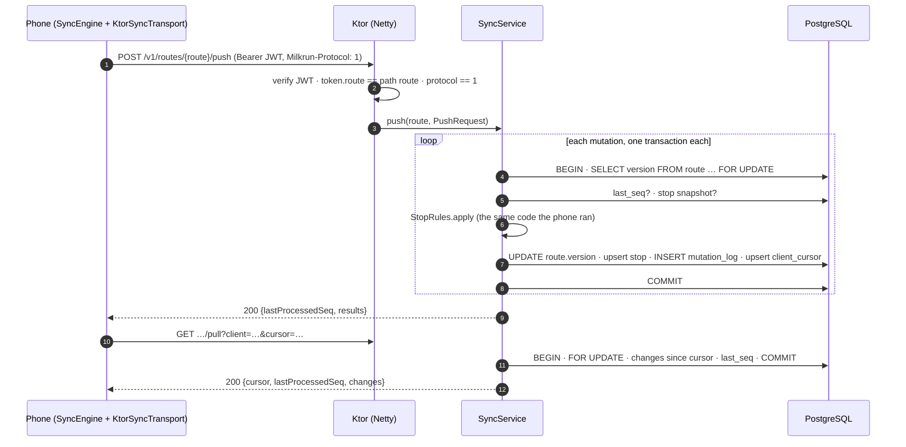

# 02 · The same mutation on the server: push, dedup, state machine, pull

> Data from `./gradlew :server:app:trace`. It starts the real Ktor/Netty server on a PostgreSQL 17
> database with `log_statement = 'all'`, drives it with the real `SyncEngine` over the real Ktor
> CIO client, and copies Postgres's own log of the statements it executed
> (`server/app/build/trace/*.sql.log`). Rows are `psql` output from that database. Values that
> depend on the wall clock (HLCs, timestamps, request ids) are from the run quoted here.

Chapter 01 followed a delivery from the driver's tap into the phone's outbox. This chapter picks it
up at the server's front door.



## 0 · Before any driver: the dispatcher plans the route

The station's dispatcher posts twelve unordered stops and the depot (SoDo, `47.58, -122.33`). The
server orders them with nearest-neighbour from the depot followed by 2-opt
([`RoutePlanner`](../../server/app/src/main/kotlin/com/milkrun/server/RoutePlanner.kt)), and creates
the route at version 1:

```
POST /v1/dispatch/routes  → 201 Created
{
    "routeId": "R-2026-11-06-DSE4-017",
    "order": [ "S-003", "S-012", "S-005", "S-009", "S-004", "S-002",
               "S-006", "S-001", "S-008", "S-011", "S-007", "S-010" ],
    "nearestNeighbourKm": 13.348347230135408,
    "optimisedKm": 11.933965265673198
}
```

```
 1. S-003 1st Ave S & S Royal Brougham Way      7. S-006 400 Broad St
 2. S-012 999 3rd Ave                           8. S-001 410 Terry Ave N
 3. S-005 1201 3rd Ave                          9. S-008 500 Fairview Ave N
 4. S-009 85 Pike St                           10. S-011 1600 E Olive Way
 5. S-004 300 Pine St                          11. S-007 1000 4th Ave
 6. S-002 2021 7th Ave                         12. S-010 701 5th Ave
```

2-opt removed **10.6 %** of the nearest-neighbour tour (13.35 → 11.93 km great-circle). This is a
first pass, not a road-network solver. `RoutePlannerTest` checks three properties: the order is a
permutation, 2-opt is never worse than nearest-neighbour (200 random instances), and the result
stays within 10 % of the brute-force optimum on 7-stop instances.

## 1 · The request

The driver's device delivers the first stop (`S-003`) and syncs. On the wire (Authorization
truncated):

```
> POST /v1/routes/R-2026-11-06-DSE4-017/push
> Authorization: Bearer eyJhbGciOiJIUzI1N…
> Milkrun-Protocol: 1
> Content-Type: application/json

< HTTP/1.1 200 OK
< Content-Type: application/json
< Content-Length: 139
< X-Request-ID: 4061c4d1-d646-4623-8871-0d6ec189eb8d
```

Three checks run before any database work:

| check | failure | tested by |
|---|---|---|
| JWT signature, issuer, audience, expiry | `401` | `ApiTest.requestsWithoutATokenAreRejected` |
| token's `route` claim equals the path's route | `403 forbidden` | `ApiTest.aDriverTokenOnlyOpensItsOwnRoute` |
| `Milkrun-Protocol` header equals the server's major | `426 unsupported_protocol` | `ApiTest.anOutdatedAppIsToldToUpgrade` |

The `426` is what powers a forced upgrade. An app too old for the server's wire format gets a
response it can recognise (`SyncHttpException.upgradeRequired`). The alternative is a
deserialization error that would look like a network failure and be retried forever.

The `X-Request-ID` is generated if the client did not send one, echoed back, and put into the
logging MDC, so every server log line for this request carries it.

## 2 · One mutation, one transaction: what Postgres actually ran

The push carried two mutations (seq 1 `arrive`, seq 2 `deliver`). From the Postgres log, the first
of the two transactions (parameters shown once):

```
LOG:  statement: BEGIN
LOG:  execute: SELECT version FROM route WHERE id = $1 FOR UPDATE
        $1 = 'R-2026-11-06-DSE4-017'
LOG:  execute: SELECT last_seq FROM client_cursor WHERE route_id = $1 AND client_id = $2
LOG:  execute: SELECT snapshot FROM stop WHERE route_id = $1 AND id = $2
LOG:  execute: UPDATE route SET version = $1 WHERE id = $2
        $1 = '2', $2 = 'R-2026-11-06-DSE4-017'
LOG:  execute: INSERT INTO stop (route_id, id, version, sequence, status, snapshot, updated_at)
               VALUES (…) ON CONFLICT (route_id, id) DO UPDATE SET …
        $1 = 'R-2026-11-06-DSE4-017', $2 = 'S-003', $3 = '2', $4 = '1', $5 = 'ARRIVED', $6 = '{"id":"S-003", …}'
LOG:  execute: INSERT INTO mutation_log (route_id, client_id, seq, stop_id, hlc, type, payload, outcome, reason)
LOG:  execute: INSERT INTO client_cursor (route_id, client_id, last_seq) VALUES ($1, $2, $3)
               ON CONFLICT (route_id, client_id) DO UPDATE SET last_seq = EXCLUDED.last_seq, …
LOG:  execute S_2: COMMIT
```

The second transaction is the same shape with `version = 3` and `status = 'DELIVERED'`. Then the
pull is one short read transaction:

```
LOG:  statement: BEGIN
LOG:  execute: SELECT version FROM route WHERE id = $1 FOR UPDATE
LOG:  execute: SELECT snapshot FROM stop WHERE route_id = $1 AND version > $2 ORDER BY sequence, id
LOG:  execute: SELECT last_seq FROM client_cursor WHERE route_id = $1 AND client_id = $2
LOG:  execute S_2: COMMIT
```

Four things to notice:

1. **The first statement locks the route.** Everything after it, on this route, is serialised
   with every other device's push and with the dispatcher. §5 shows why that is the correctness
   argument for the pull cursor, and what it costs.
2. **`StopRules` runs between the reads and the writes.** It is the same compiled function the
   phone used for its optimistic update (chapter 01 §2). The server's answer can differ from the
   phone's only because the server's input can differ, for example a stop the dispatcher
   cancelled.
3. **The ruling and the dedup watermark are written in the same transaction as the effect.**
   There is no state where the stop is `DELIVERED` but `last_seq` still says 1, which is what
   makes a retry after a lost response safe.
4. **The pull reads `version`, the changes and `last_seq` under the same lock**, so they are
   mutually consistent. If `last_seq ≥ s`, then mutation `s`'s effect is in `changes`.

Postgres's own timings for all three transactions (parse + bind + execute of every statement):
**3.8 ms in total**, with each `COMMIT` taking 0.085–0.115 ms. That commit time is low because macOS
`fsync` does not flush the drive's write cache. On Linux with `synchronous_commit = on` and a real
disk, the commit, which waits for the WAL flush, would dominate. That is the production cost of the
durability that ADR 0002 depends on.

## 3 · The rows

```
milkrun_trace=# SELECT id, version FROM route WHERE id = 'R-2026-11-06-DSE4-017';
          id           | version
-----------------------+---------
 R-2026-11-06-DSE4-017 |       3

milkrun_trace=# SELECT id, version, sequence, status FROM stop
                WHERE route_id = 'R-2026-11-06-DSE4-017' ORDER BY version DESC, sequence LIMIT 3;
  id   | version | sequence |  status
-------+---------+----------+-----------
 S-003 |       3 |        1 | DELIVERED
 S-012 |       1 |        2 | PLANNED
 S-005 |       1 |        3 | PLANNED

milkrun_trace=# SELECT route_id, client_id, last_seq FROM client_cursor;
       route_id        | client_id | last_seq
-----------------------+-----------+----------
 R-2026-11-06-DSE4-017 | q7m2x9ka  |        2

milkrun_trace=# SELECT seq, stop_id, hlc, type, outcome, reason, payload FROM mutation_log ORDER BY seq;
 seq | stop_id |              hlc               |  type   | outcome  | reason | payload
-----+---------+--------------------------------+---------+----------+--------+------------------------------------------------
   1 | S-003   | 0001793963686644-0000-q7m2x9ka | arrive  | accepted |        | {"type": "arrive", "stopId": "S-003", "atMillis": 1793963686640}
   2 | S-003   | 0001793963686654-0000-q7m2x9ka | deliver | accepted |        | {"type": "deliver", "stopId": "S-003", "handoff": "front_door",
                                                                                     "atMillis": 1793963686654, "parcelIds": ["TBA318840200003"]}
```

- `stop.version` is the route version at the stop's last change. `S-003` went 1 → 2 (arrive) → 3
  (deliver); the other eleven are still at 1. A pull with `cursor = 1` returns exactly one stop.
- `mutation_log.payload` is `jsonb`, so Postgres normalised the key order (`handoff` before
  `parcelIds`). Nothing reads key order: the phone decodes it with `ignoreUnknownKeys` into the same
  `Mutation` type.
- `mutation_log.type` is the wire name (`arrive`, `deliver`), the same string the phone's outbox
  uses (chapter 01). *Found while writing this chapter:* the first version stored the Kotlin class
  name (`Arrive`). That was harmless but inconsistent across the two databases, and it leaked into
  metric labels. Both now use `Mutation.wireName`.

The pull query uses the `stop_changes (route_id, version)` index:

```
EXPLAIN (ANALYZE, BUFFERS, COSTS OFF)
SELECT snapshot FROM stop WHERE route_id = 'R-2026-11-06-DSE4-017' AND version > 1 ORDER BY sequence, id;

 Sort (actual time=0.030..0.031 rows=1 loops=1)
   Sort Key: sequence, id
   Sort Method: quicksort  Memory: 25kB
   Buffers: shared hit=6
   ->  Index Scan using stop_changes on stop (actual time=0.026..0.026 rows=1 loops=1)
         Index Cond: ((route_id = 'R-2026-11-06-DSE4-017'::text) AND (version > 1))
 Planning Time: 0.226 ms
 Execution Time: 0.057 ms
```

## 4 · The same push again

Replaying the identical request body (seqs 1 and 2) returns the stored rulings:

```
200 OK {"lastProcessedSeq":2,"results":[{"seq":1,"outcome":"accepted"},{"seq":2,"outcome":"accepted"}],
        "serverHlc":"0001793963686774-0000-server"}
```

and Postgres runs only reads, per seq:

```
LOG:  statement: BEGIN
LOG:  execute S_6: SELECT version FROM route WHERE id = $1 FOR UPDATE
LOG:  execute S_7: SELECT last_seq FROM client_cursor WHERE route_id = $1 AND client_id = $2      → 2
LOG:  execute: SELECT outcome, reason FROM mutation_log WHERE route_id = $1 AND client_id = $2 AND seq = $3
LOG:  execute S_2: COMMIT                                                (duration: 0.072–0.105 ms)
```

No `UPDATE`, no `INSERT`: `route.version` stays 3. The metrics endpoint counts the replay:

```
milkrun_push_duplicates_total 2.0
milkrun_rulings_total{outcome="accepted",reason="none",type="arrive"} 1.0
milkrun_rulings_total{outcome="accepted",reason="none",type="deliver"} 1.0
```

Answering from `mutation_log` rather than re-running `StopRules` is essential here. A re-run of
seq 2 against the now-delivered stop would answer `already_delivered`, telling the driver that a
delivery which succeeded had failed.

## 5 · Why every write locks the route

The pull cursor is "every stop with `version > n`". That is correct only if versions commit in
order. Here is what goes wrong with a global sequence instead of a locked counter:

```
  tx A (driver)                  tx B (dispatcher)               pull
  nextval → 41
                                 nextval → 42
                                 write stop X @42, COMMIT
                                                                 sees max version 42 → cursor = 42
  write stop Y @41, COMMIT
                                                                 next pull: version > 42 … Y@41 is never sent
```

With `SELECT version FROM route WHERE id = ? FOR UPDATE`, B cannot read the version until A
commits, so commit order is version order. Two `psql` sessions show the lock directly. Session A
holds the route for 3 s (`BEGIN; SELECT … FOR UPDATE; SELECT pg_sleep(3); COMMIT`), and while it
does:

```
-- session B, same route, lock_timeout = 1s
SELECT version FROM route WHERE id='R-2026-11-06-DSE4-017' FOR UPDATE;
ERROR:  canceling statement due to lock timeout
CONTEXT:  while locking tuple (0,3) in relation "route"
Time: 1002.207 ms (00:01.002)

-- session C, a different route
SELECT version FROM route WHERE id='R-LAT-4-1' FOR UPDATE;
Time: 0.747 ms

-- session D, same route, no timeout: waits for A to commit
SELECT version FROM route WHERE id='R-2026-11-06-DSE4-017' FOR UPDATE;
 version
---------
       3
Time: 1242.792 ms (00:01.243)
```

The cost of the lock is bounded by the domain. One route has one driver, sometimes a helper, and
one dispatcher, so at most a handful of transactions ever queue on one route row. A station's 200
routes are 200 independent locks. The concurrency contract test makes this executable: 8 writers ×
25 commands on one route must produce exactly versions 2…201 on PostgreSQL, and they do.

## 6 · The chaos simulator, on Postgres

`PostgresSimulationTest` runs the chapter 01 chaos shifts (two devices, lost requests and
responses, stale duplicates, dead zones, restarts, dispatcher cancels) with `PostgresSyncStore`
behind the `SyncService`. JDBC runs inline on the simulator's scheduler, which keeps every run
deterministic. 200 seeds:

```
./gradlew :server:app:test --tests '*PostgresSimulationTest' -PpgSimSeeds=200
  200 routes · 13,294 rulings in mutation_log (2,347 rejected) · 0 invariant violations · 30.5 s
```

The default CI run uses 25 seeds.

## 7 · Latency, honestly

`syncOnce()` with one pending mutation (one push + one pull) over localhost HTTP, N drivers on N
routes concurrently, after three warm-up rounds. Server-side means come from Ktor's request timers
(`ktor_http_server_requests_seconds`):

| drivers | p50 | p90 | p99 | server push (mean) | server pull (mean) |
|---|---|---|---|---|---|
| 1 | 14.9 ms | 17.4 ms | 17.9 ms | 5.5 ms | 4.4 ms |
| 8 | 22.2 ms | 45.9 ms | 84.7 ms | 17.5 ms | 13.6 ms |
| 32 | 68.7 ms | 175.8 ms | 340.1 ms | 37.5 ms | 27.4 ms |

**Treat these numbers as an upper bound with an unknown error bar.** They were taken while the
machine was compiling other projects (`vm.loadavg` = 32.9 / 29.9 / 42.2 on 12 cores). Seven runs of
the same trace gave p50s between 14.9 and 39.6 ms at one driver. What the data does support:

- The SQL itself is not the bottleneck. Postgres reports ~1.3 ms per transaction including
  parse/bind, against 5.5 ms of server time per push. The remainder is JSON, Ktor, the pool and
  CPU contention.
- Per-mutation transactions have a visible price. The two transactions of one push started 6 ms
  apart in the Postgres log. One transaction per batch would amortise that. The trade-off is that a
  single bad mutation could no longer be ruled on and committed independently of its batch. That
  change is deferred until a clean load test (M7, on dedicated hardware) shows it matters.

## 8 · Running it as a service

The same `main()` that the trace uses runs the server. Configuration comes from the environment,
and Flyway migrates on start:

```
$ PORT=18090 DATABASE_URL=jdbc:postgresql://localhost:55432/milkrun_local JWT_SECRET=… java -jar milkrun-server.jar
INFO  o.f.c.i.c.DbMigrate - Migrating schema "public" to version "1 - sync schema"
INFO  o.f.c.i.c.DbMigrate - Successfully applied 1 migration to schema "public", now at version v1 (execution time 00:00.019s)
INFO  milkrun - milkrun server starting on :18090
INFO  i.k.s.Application - Responding at http://0.0.0.0:18090
$ curl -i localhost:18090/readyz           → HTTP/1.1 200 OK
$ curl localhost:18090/v1/routes/R-1/pull  → 401
```

`server/app/Dockerfile` (Corretto 21 Alpine, non-root, container-aware heap, health check) and
`docker-compose.yml` package the same jar. CI builds the image and boots it against Postgres on
every push. (The development Mac's Docker daemon was down while this was written, so the local
runs above used a native PostgreSQL 17.)

## Reproduce

```bash
# any PostgreSQL 17; the server tests also run without this via Testcontainers
export MILKRUN_TEST_DATABASE_URL=jdbc:postgresql://localhost:55432/milkrun_test
./gradlew :server:app:test                                   # contract, API, planner, Postgres chaos
./gradlew :server:app:test --tests '*PostgresSimulationTest' -PpgSimSeeds=200
./gradlew :server:app:trace -PpgAdminUrl=jdbc:postgresql://localhost:55432/postgres -PpgLog=<postgres log file>
```

Code: [`Application.kt`](../../server/app/src/main/kotlin/com/milkrun/server/Application.kt) ·
[`PostgresSyncStore`](../../server/app/src/main/kotlin/com/milkrun/server/PostgresSyncStore.kt) ·
[`V1__sync_schema.sql`](../../server/app/src/main/resources/db/migration/V1__sync_schema.sql) ·
[`SyncService`](../../server/core/src/main/kotlin/com/milkrun/server/sync/SyncService.kt) ·
[`SyncStoreContract`](../../server/core/src/testFixtures/kotlin/com/milkrun/server/sync/SyncStoreContract.kt) ·
[`KtorSyncTransport`](../../shared/network/src/commonMain/kotlin/com/milkrun/network/KtorSyncTransport.kt)
