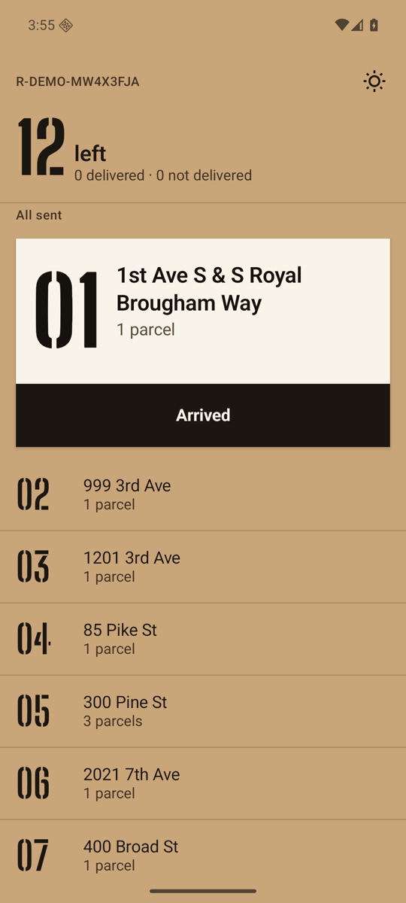
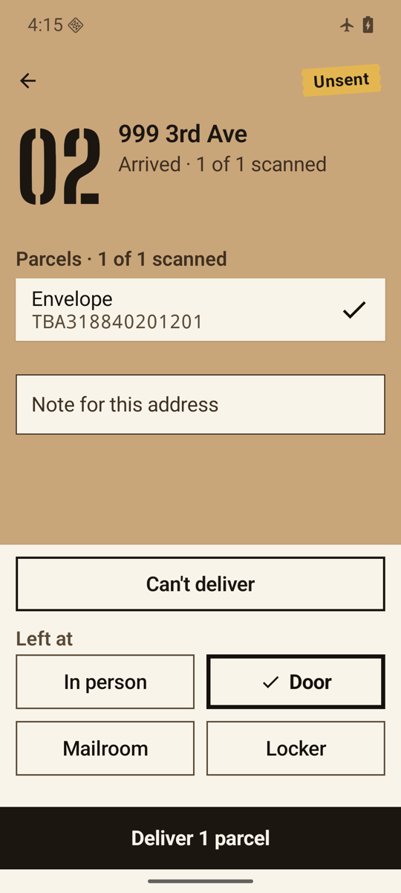
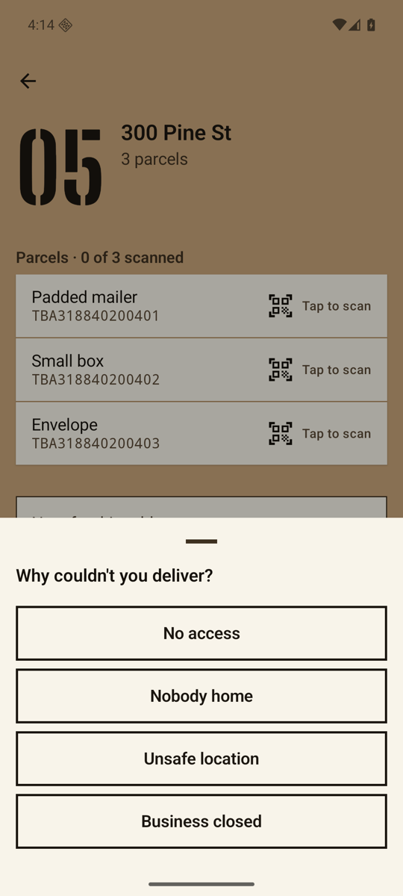
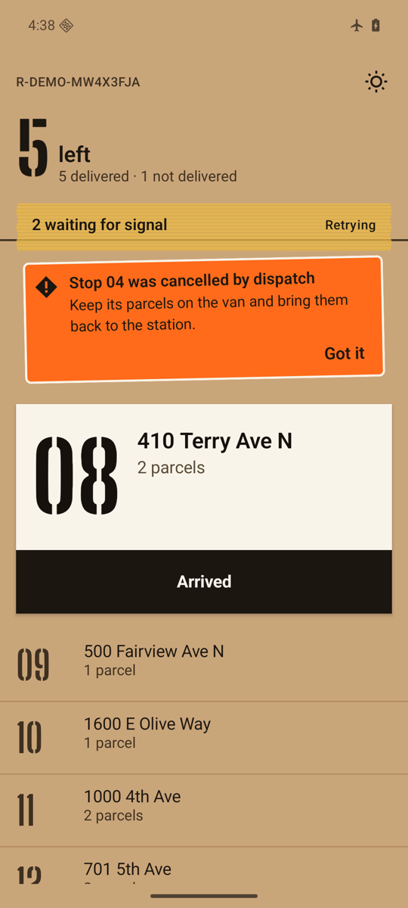
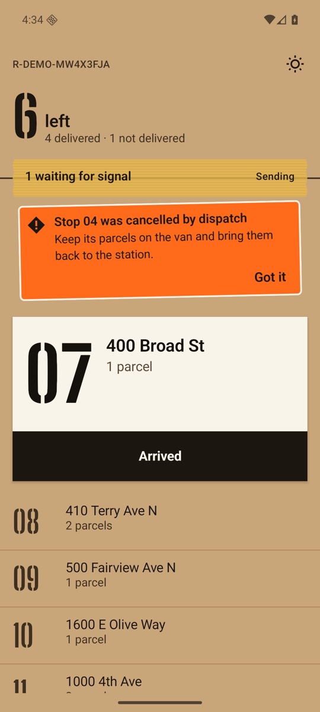
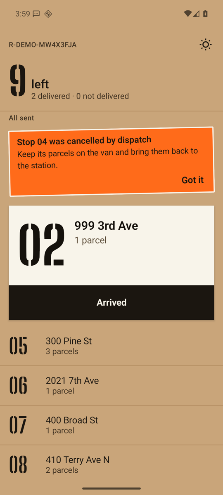
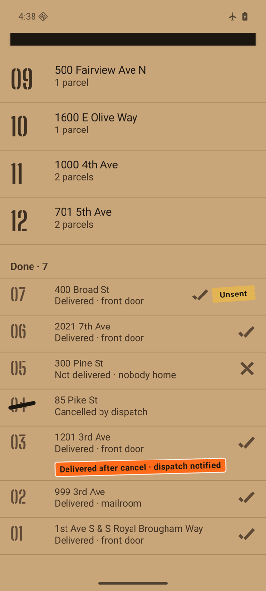
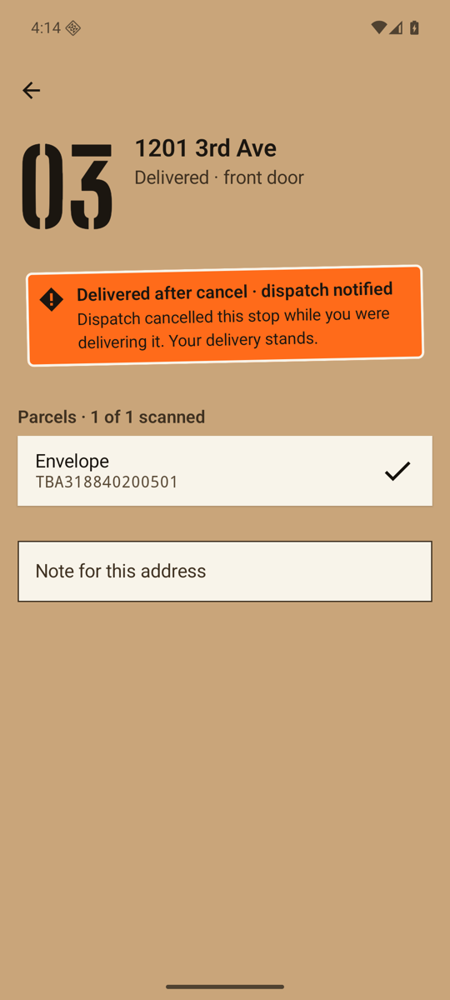
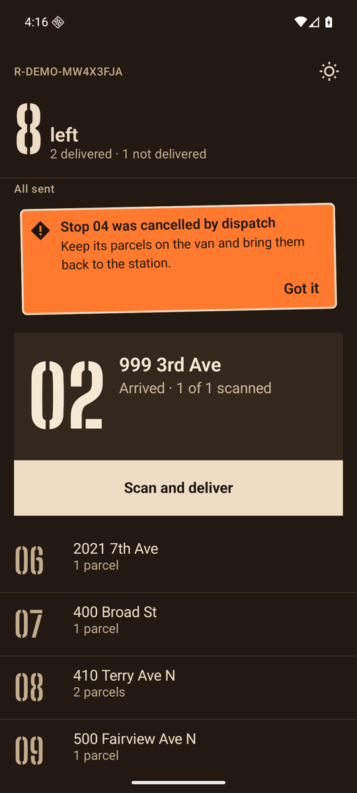
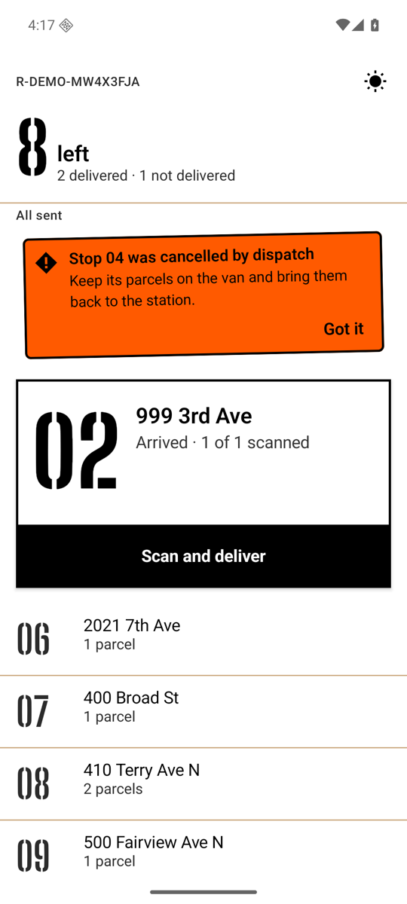

# 03 · Android: one stop, from a thumb on the glass to a row in SQLite

> Every screenshot here comes from the Android emulator (Pixel 8 profile, API 36, 1080×2400) running
> the debug build against the real server and PostgreSQL from chapter 02, started in dev mode
> (`MILKRUN_DEV_MODE=true`, `POST /v1/dev/session` seeds a synthetic Seattle route). Database rows
> were pulled from the device with `adb exec-out run-as com.milkrun.driver cat databases/…` and
> read with `sqlite3`. Device actions were driven by `tools/devices/adb_ui.py`.

## The world the screens are drawn in

The driver works a stack of boxes, so the UI uses the packing room's own marks instead of list
cells and status chips. The direction was chosen through the impeccable design process and is
recorded in `PRODUCT.md`, `.impeccable/surfaces/` and [`design/DESIGN.md`](../../design/DESIGN.md).

| mark | means | where in code |
|---|---|---|
| kraft ground, label-white stock | the route, and the one stop that is lifted off it | `MilkrunTheme`, `NextStop` |
| condensed stencil number | a stop's headline (96 sp next, 40 sp upcoming, 28 sp done) | `StencilType`, Big Shoulders Stencil (OFL) |
| translucent packing tape | done on the phone, not yet confirmed by the server | `TapeStrip`, `TapeTab` |
| safety-orange exception sticker with a hazard mark | the server ruled against something | `ExceptionSticker`, `HazardMark` |
| thick marker strike | cancelled by dispatch | `MarkerStrike` |
| stencilled check and cross | delivered / not delivered | `StencilMark` |

No state is carried by colour alone: every one of these marks has a shape, and every row has a
text status.

<p>



</p>

*Start of shift · a stop at 1.3× font scale · the "can't deliver" reasons.*

## 1 · The tap

The driver is at stop 02 (`999 3rd Ave`), in a lift, with no signal. They choose **Mailroom** and
press **Deliver 1 parcel**. In `MainActivity` that click calls the shared screen model:

```kotlin
onDeliver = { h -> scope.launch { report(model.deliver(id, d.parcels.map { it.id }, h), done = true) } }
```

`RouteScreenModel` lives in `shared/presentation`, and the iOS app uses the same class. It turns the
tap into a `Mutation.Deliver` and calls `SyncEngine.record`, which is the transaction from chapter
01: rules, then an outbox row, then the view row. The Compose screen never writes to the database
itself, and nothing on the screen waits for the network.

## 2 · The row on the phone

Pulled from the emulator right after the tap (`route-R-DEMO-MW4X3FJA.db`):

```
sqlite> PRAGMA journal_mode;
wal

sqlite> SELECT seq, stop_id, hlc, type, created_at FROM outbox;
seq  stop_id  hlc                             type     created_at
---  -------  ------------------------------  -------  -------------
9    S-012    0001793967541296-0000-aahdemtf  deliver  1793967541296

sqlite> SELECT payload FROM outbox;
{"type":"deliver","stopId":"S-012","parcelIds":["TBA318840201201"],"handoff":"mailroom","atMillis":1793967541283}

sqlite> SELECT id, sequence, status, handoff, pending FROM stop WHERE status != 'PLANNED' ORDER BY sequence;
id     sequence  status     handoff     pending
-----  --------  ---------  ----------  -------
S-003  1         DELIVERED  FRONT_DOOR  0
S-012  2         DELIVERED  MAILROOM    1
S-005  3         DELIVERED  FRONT_DOOR  0
S-009  4         CANCELLED              0
S-004  5         ATTEMPTED              0

sqlite> SELECT * FROM sync_meta;
key        value
---------  ------------------------------
client_id  aahdemtf
cursor     10
next_seq   10
hlc        0001793967541296-0000-aahdemtf
```

What the rows say:

- **WAL on Android.** `AndroidDatabase` turns on write-ahead logging, so the UI's reads never wait
  for a commit (`PRAGMA journal_mode` → `wal`).
- **One outbox row, `pending = 1` on the stop.** Seqs 1–8 have already been confirmed and deleted.
  Seq 9 is the delivery made in the lift.
- **`atMillis` 13 ms before the HLC.** The screen model stamps the action when the driver taps. The
  engine's clock ticks when the transaction runs. Both are kept: the first for the audit trail, the
  second for ordering.
- **The view already says `DELIVERED`.** The SQLDelight query behind `RouteScreenModel.state`
  re-runs after the commit, and Compose recomposes. The route moves on to the next stop at once.

## 3 · What the driver sees

<p>



</p>

*Offline with two actions waiting · signal back, sending · the server's ruling.*

- **Offline.** The tape strip reads "2 waiting for signal · Retrying". It is translucent, so the
  box's fluting rule shows through its lower third and runs out past the torn ends. The next stop carries an **Unsent**
  tab that crosses the label's top edge.
- **Sending.** The network is up and no request has failed yet. To hold this state long enough for
  a screenshot, the local server was frozen with `SIGSTOP` while a push was in flight. This capture
  predates a copy fix: the strip then read "1 waiting for signal · Sending", which is untrue when
  there is signal. It now reads "Sending 1 change" and says "waiting for signal" only after a send has
  failed (`SyncBanner.Waiting.title`, covered by `RouteScreenModelTest`).
- **Back in range.** When signal returned, the server log shows the outbox push landing within about
  a second (`04:38:10.460 200 OK: POST /v1/routes/R-DEMO-MW4X3FJA/push in 140ms`). The connectivity
  callback cut the backoff sleep short.
- **The ruling.** While the phone was offline, the dispatcher cancelled stop 04 and the driver
  tapped *Arrived* there. When the phone pushed, the server rejected the arrival
  (`STOP_CANCELLED`). The rejection came back on the push response and was written to the
  `rejection` table:

  ```
  sqlite> SELECT seq, stop_id, type, reason, seen FROM rejection;
  seq  stop_id  type    reason          seen
  ---  -------  ------  --------------  ----
  5    S-009    arrive  STOP_CANCELLED  0
  ```

  `Copy.rejection` turns it into the sticker: "Stop 04 was cancelled by dispatch. Keep its parcels on
  the van and bring them back to the station." **Got it** sets `seen = 1`.

  The same dispatcher also cancelled stop 03, which the driver had already delivered offline. The
  server accepted that delivery and flagged it, and the stop carries the small *Delivered after
  cancel · dispatch notified* tag (chapter 02 §2).

<p>




</p>

*Done stops recede in size and ink: cross for not delivered, strike for cancelled, checks for
delivered · the stop screen after an overridden cancel · Night · Sun.*

## 4 · How the outbox drains when the app is not on screen

| trigger | code | what it does |
|---|---|---|
| a mutation is recorded | `SyncEngine.record` → `wake` channel | the `run()` loop syncs immediately |
| signal returns | `ConnectivityManager.registerDefaultNetworkCallback` in `MilkrunApp` | `refresh()` cuts the backoff sleep short |
| app comes to the foreground | `LifecycleEventEffect(ON_START)` | `refresh()` |
| app in background or killed | `SyncWorker` (WorkManager, every 15 min, requires a network) | one `syncOnce()` on the process's session |

There is one `MilkrunSession` per process, so the worker, the connectivity callback and the screens
all share one engine and one mutex. Two engines never write the same database.

The route database is one file per route (`route-<id>.db`), so ending a shift is deleting one file.
`data_extraction_rules.xml` keeps the database and the preferences out of cloud backup and
device-to-device transfer, because route data contains customer addresses.

## 5 · Built to be checked

- **Roborazzi goldens.** `android/app/src/test/snapshots/` holds eight golden images rendered with
  Robolectric: route (kraft, night, sun, sending, finished) and stop (kraft, night, sun). CI runs
  `verifyRoborazziDebug` with a 1 % pixel tolerance, enough for macOS-recorded and Linux-verified
  anti-aliasing but not for a layout or colour change.
- **Shared logic tests.** `RouteScreenModelTest` covers which stop is next, the tape, the copy for
  rulings and which actions are legal. It runs on JVM, the Android host and the iOS simulator.
- **Design review.** A fresh reviewer agent (no access to the build conversation) checked the
  emulator captures against the direction contract, four times.
  - **Round 1** found 8 material problems:
    - handoff labels truncated at 1.3× font scale;
    - a dark sticker edge in Night;
    - Done rows that did not recede;
    - tape that read as an opaque banner;
    - no mark for the "attempted" state;
    - a selected handoff option styled exactly like the Deliver button;
    - a white label lost on the white Sun ground;
    - a duplicated title.
  - **Rounds 2–4** re-scored each fix on new device captures, and rejected two captures as invalid
    evidence (a cold-start splash, and a Robolectric render offered in place of a device shot).
  - **Final verdict:** every scored fix resolved. Two small regressions it found in the last round
    were fixed afterwards and checked on the emulator, but have not been re-reviewed:
    - the fluting rule crossed the tape's text;
    - the Unsent tab covered a done row's check.

## Numbers

| | |
|---|---|
| release APK (R8, minified) | 3.97 MB (`app-release-unsigned.apk`, 3,965,919 bytes) |
| debug APK | 72.1 MB |
| cold start, debug build, emulator | `am start -W` TotalTime **3,534 ms** |

The cold start is from a debug build (no R8, no baseline profile) on a software-rendered emulator,
on a host under load (other projects compiling). Treat it as an upper bound only. A macrobenchmark
with a baseline profile on hardware is the real measurement, and it is still to do.

## Reproduce

```bash
# server in dev mode on a free port (8080 was taken on the dev machine)
PORT=18081 MILKRUN_DEV_MODE=true DATABASE_URL=jdbc:postgresql://localhost:55432/milkrun_local \
  JWT_SECRET=local-secret-local-secret-local-secret java -jar server/app/build/libs/milkrun-server.jar
./gradlew :android:app:installDebug -PmilkrunServerUrl=http://10.0.2.2:18081
adb shell cmd connectivity airplane-mode enable      # go into the lift
python3 tools/devices/adb_ui.py tapx "Deliver 1 parcel"
adb exec-out run-as com.milkrun.driver cat databases/route-<id>.db > phone.db   # plus -wal, -shm
./gradlew :android:app:verifyRoborazziDebug
```
