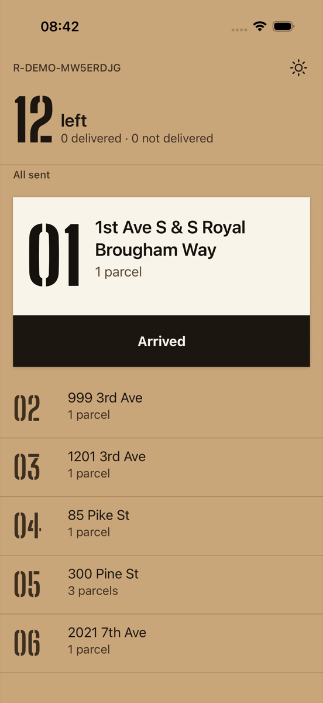
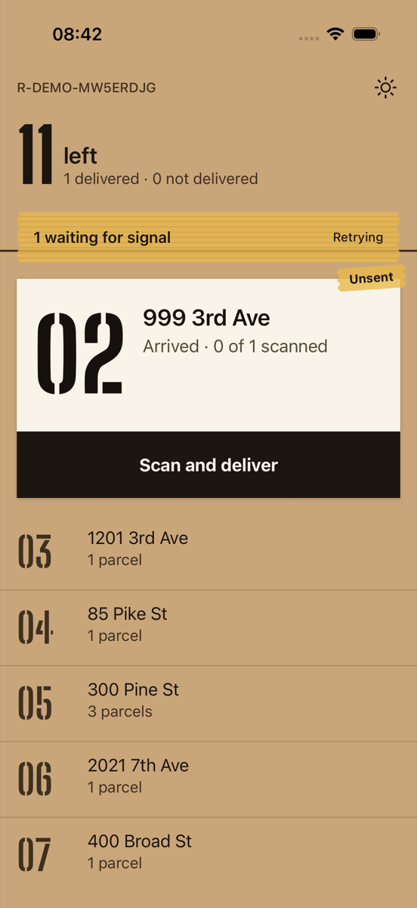
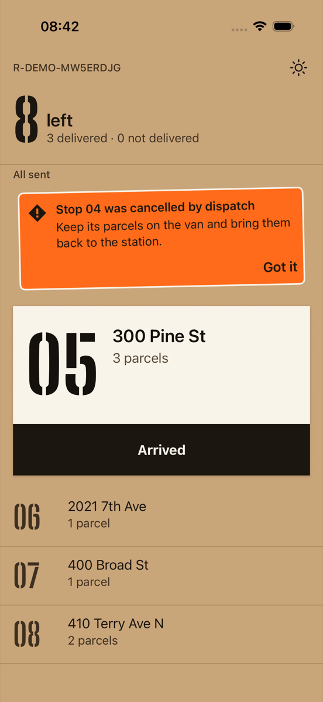
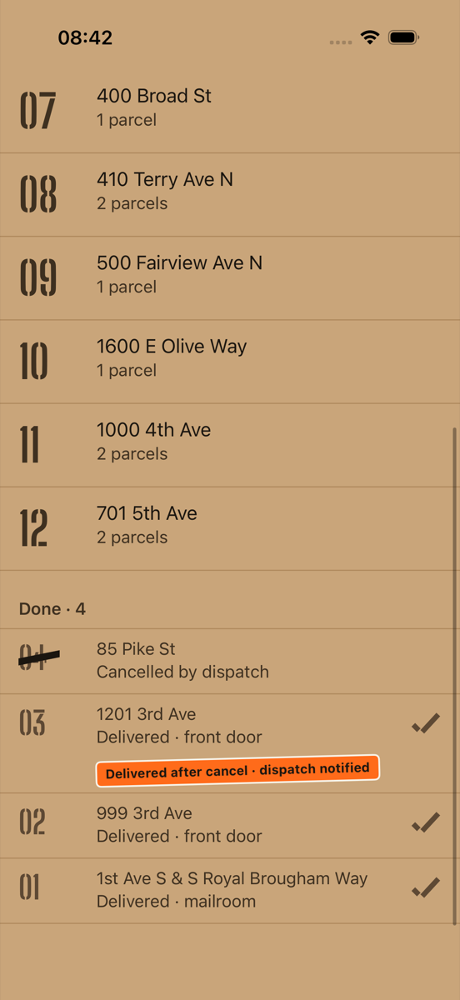
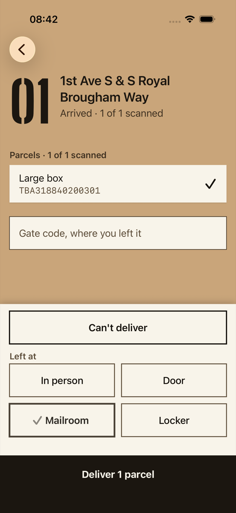
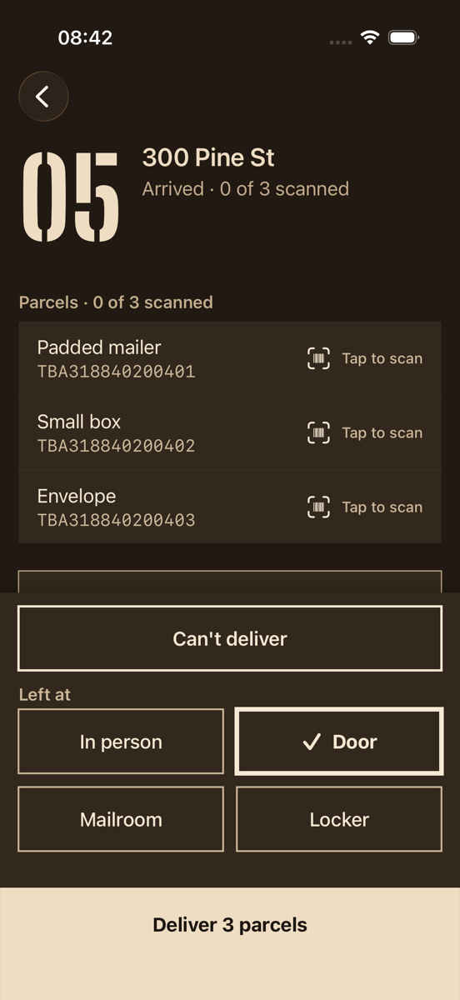
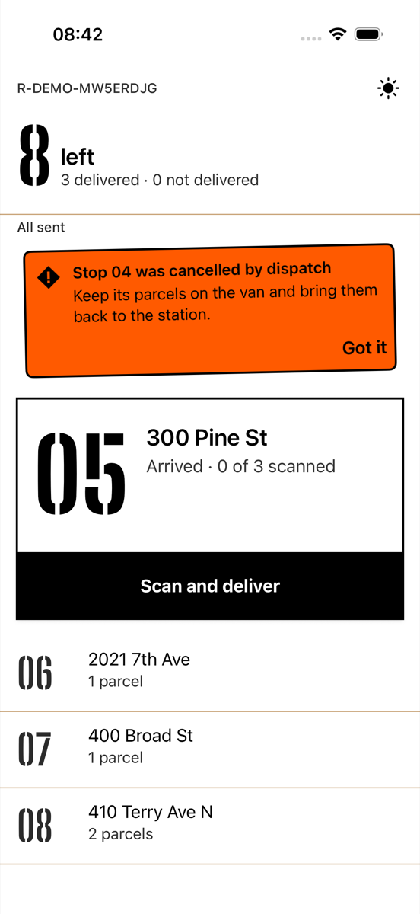
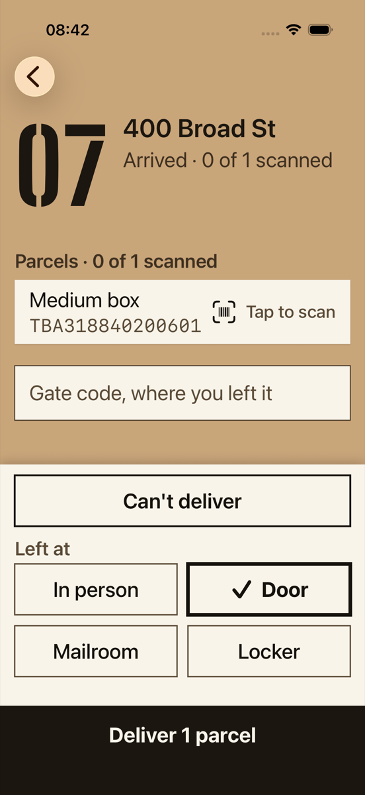
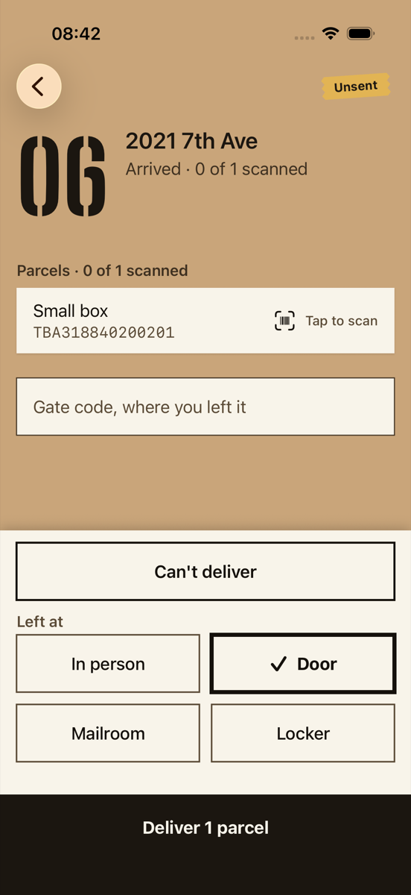
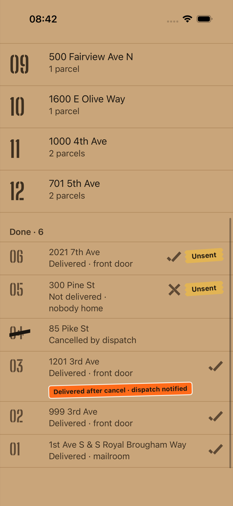

# 04 · iOS: the same stop through MilkrunKit and SwiftUI

> Screenshots come from the iOS Simulator (iPhone 17 Pro, iOS 26.1) and were taken by an XCUITest,
> `ios/MilkrunUITests/ShiftUITests.swift`. The test drives one shift against the same local server
> and PostgreSQL as chapters 02–03, and attaches a screenshot at every state. Header and interface
> excerpts are from the built `MilkrunKit.xcframework`. The crash trace is from the simulator's
> unified log.

## What crosses the bridge

The iOS app links one static framework, built by `:shared:kit`:

```
shared:model · protocol · database · sync · network · presentation
        └────────── Kotlin/Native ──────────┘
                     │  + SKIE 0.10.16 (Swift wrappers compiled into the framework)
                     ▼
        MilkrunKit.xcframework   (ios-arm64, ios-arm64-simulator; 68 MB static debug binary)
                     │
                     ▼
        Milkrun.app (SwiftUI, Swift 6, SWIFT_STRICT_CONCURRENCY = complete)   17 MB debug
```

SKIE turns Kotlin's coroutine and sealed-class APIs into native Swift. These are the actual lines
from the framework's `arm64-apple-ios-simulator.swiftinterface`:

```swift
public func deliver(stop: Any, handoff: MilkrunKit.HandoffMethod) async throws -> any MilkrunKit.RecordResult
public func onEnum<__Sealed>(of sealed: __Sealed) -> MilkrunKit.Skie.Model.Mutation.__Sealed where __Sealed : MilkrunKit.Mutation
```

So the SwiftUI side reads like ordinary Swift:

```swift
let session = try await Milkrun.shared.start(serverUrl: Self.serverURL)   // Kotlin suspend → async
for await state in session.screen.state { route = state }                // StateFlow → AsyncSequence

switch onEnum(of: state.sync) {                                          // sealed class → exhaustive enum
case .waiting(let w): TapeStrip(title: w.title, detail: w.detail)
case .allSent:        Fluting()
}
```

`MilkrunTests` (Swift Testing, 5 tests) pins the bridge. Kotlin enums arrive as Swift enums with
all their cases. `SyncBanner` switches exhaustively. And `Copy.shared.rejection(stop: "04", …)`
returns the same sentence the Android sticker shows.

## The bug the bridge hid

The first version of `RouteScreenModel.deliver` took the parcel list from the caller:

```kotlin
public suspend fun deliver(stop: StopId, parcels: List<ParcelId>, handoff: HandoffMethod): RecordResult
```

```objc
- (void)deliverStop:(id)stop parcels:(NSArray<id> *)parcels handoff:(MilkrunKitHandoffMethod *)handoff …
```

It compiled, and the Android app and every Kotlin test used it correctly. On iOS the first tap on
*Deliver* killed the app:

```
Milkrun uncaught Kotlin exception: kotlin.ClassCastException: class kotlin.String cannot be cast to class com.milkrun.model.ParcelId
    at …  kfun:kotlin.native.internal#downcast(…)
    at …  kfun:com.milkrun.model.StopRules.deliver#internal
```

`ParcelId` is a Kotlin `value class`. When it is a single parameter (`stop: Any`), the ObjC bridge
boxes and unboxes it correctly. But `ParcelRow.id` reaches Swift as the underlying `String`, and a
`List<ParcelId>` is erased to `NSArray<id>`. So the array Swift built was an array of strings, and
nothing checked it until `StopRules` read an element.

Finding it took two things:

- **A crash hook.** Kotlin/Native writes uncaught exceptions to stderr, and iOS discards stderr.
  `Milkrun.start` now installs `setUnhandledExceptionHook`, which sends the stack to `NSLog`. That
  hook itself crashed the first time. `NSLog` is variadic, and a Kotlin `String` passed as a `%@`
  argument is not bridged to `NSString`, so the message now goes into the format string with `%`
  escaped.
- **A UI test that actually delivers.** Unit tests on both sides passed throughout, because none
  of them built that list in Swift.

The fix is in the API: `deliver(stop:handoff:)` now looks up the stop's parcels in shared code, so
no collection of value classes crosses the bridge. A single value-class parameter or return value is
safe, but a collection of value classes is not.

## One shift, on iOS

`ShiftUITests.testOneShift` runs the whole story in 111 seconds (the final passing run). There is
no airplane mode on the simulator, so "the lift" is the app relaunched with
`-serverURL http://localhost:9`, a dead port. The dispatcher's cancels are real API calls from the
test runner to the server.

| step | what happens | capture |
|---|---|---|
| 1 | `-resetSession` → `POST /v1/dev/session` → a fresh Seattle route | `01-route-kraft` |
| 2 | arrive, scan, Mailroom, Deliver, online | `02-stop` |
| 3 | relaunch against the dead port, arrive at 02 | `03-offline` |
| 4 | the test calls `POST /v1/dispatch/routes/{id}/commands` to cancel 03 and 04 | |
| 5 | still offline: deliver 02, arrive at and deliver 03, arrive at 04 | |
| 6 | relaunch online; the outbox drains; the server rules | `04-ruling`, `05-done` |
| 7 | Night, pinned with `-forceScheme night` | `06-night`, `07-night-stop` |
| 8 | Sun toggle | `08-sun`, `08b-sun-stop` |
| 9 | offline again: *Can't deliver · Nobody home* at 05, deliver 06 | `10-stop-unsent`, `11-done-offline` |
| 10 | Dynamic Type XXXL (≈1.3× body) | `09-xxxl-stop` |

<p>




</p>
<p>




</p>

### A second bug, found because iOS ran the flow differently

In step 5 the iOS test taps **Arrived** at stop 03 before delivering it. The Android script in
chapter 03 went straight to *Scan and deliver*. Then the outbox drains:

- `arrive(03)` is **rejected**, `stop_cancelled`, because the dispatcher had already cancelled it.
- `deliver(03)` is **accepted** and flagged `delivered_after_cancel`.

The first build showed both: a sticker saying "Stop 03 was cancelled by dispatch. Keep its parcels on
the van and bring them back to the station", directly above a row saying the stop was delivered.
`RouteScreenModel` now drops rulings on stops that ended up delivered, because the delivery made
them moot. The regression test is
`RouteScreenModelTest.aRejectedArrivalIsNotShownOnceTheStopIsDelivered`, and it runs on JVM, Android
and iOS, so both apps get the fix.

## Same world, iOS structure

What stays identical is everything in `design/DESIGN.md`:

- the tokens, Kraft `#C9A57A` (sampled the same on both platforms by the reviewer), Night `#211912`
  and Sun `#FFFFFF`;
- the stencil face at the same sizes;
- the tape, sticker, marker strike and stencil marks, drawn in SwiftUI `Canvas` the way Compose
  draws them;
- the 64 pt Deliver block below a 32 pt gap;
- every sentence the driver reads.

What follows the HIG instead:

| | Android | iOS |
|---|---|---|
| navigation | `NavHost`, system Back | `NavigationStack`, edge-swipe back, the system's iOS 26 back control |
| can't-deliver reasons | Material bottom sheet | `confirmationDialog` (action sheet) |
| refusal | snackbar | alert |
| icons | Material Symbols | SF Symbols (`barcode.viewfinder` for the linear TBA labels) |
| type scaling | `sp` + font scale | `Font.custom(_:size:relativeTo:)` with Dynamic Type |
| background drain | WorkManager (15 min) | `BGTaskScheduler` app refresh (`com.milkrun.sync`) |
| unsent tab on the stop bar | top app bar action | toolbar item with iOS 26's shared glass background turned off, so the tape is not floated in a capsule |

## Review

A fresh reviewer checked the first iOS captures against the direction contract, DESIGN.md and the
Android captures that had already passed. It scored type, material, grounds, the header, the
tape strip, the lifted label, the sticker and the dock as matching. It asked for 7 fixes:

1. rows slid under the clock while scrolling;
2. the tape's peel animation and row-tab animation did not match DESIGN.md;
3. the tilts under Reduce Motion did not match DESIGN.md;
4. the delivered-after-cancel tag wrapped, leaving a dangling "·";
5. iOS 26 put the toolbar tape inside a glass capsule;
6. the dock's zero-offset shadow was decoration, not depth;
7. the not-delivered and unsynced done rows had no captures.

All seven were fixed in one batch, and steps 9–10 of the test were added to cover the missing
states. Those new captures exposed one more bug, a SwiftUI identity collision. The upcoming list
and the done list both used the stop id as `ForEach` identity, so a stop that moved from one to
the other could keep the upcoming row's stale view. Stop 06 sat in *Done* still reading "1
parcel", with no check and no tape. Done rows now use their own `done-<id>` identity, as the
Compose list already did, and `11-done-offline` shows the row correctly. These fixes were checked
on new captures but have not had a second review pass.

<p>


</p>

## Reproduce

```bash
# server in dev mode as in chapter 03, on :18081
ios/build-kit.sh                                   # MilkrunKit.xcframework + xcodegen
xcodebuild -project ios/Milkrun.xcodeproj -scheme Milkrun  -destination 'platform=iOS Simulator,name=iPhone 17 Pro' test   # Swift tests
xcodebuild -project ios/Milkrun.xcodeproj -scheme MilkrunShift -destination 'platform=iOS Simulator,name=iPhone 17 Pro' -resultBundlePath shift.xcresult test
xcrun xcresulttool export attachments --path shift.xcresult --output-path shots/
```
