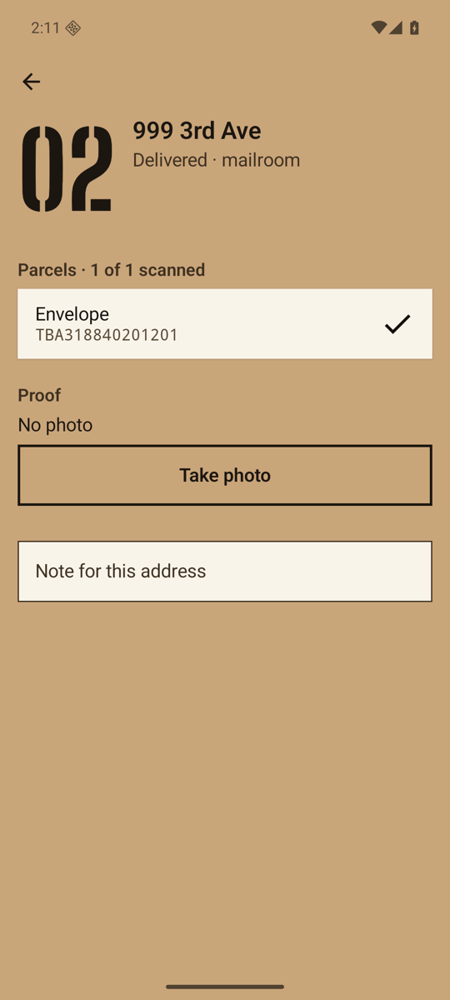
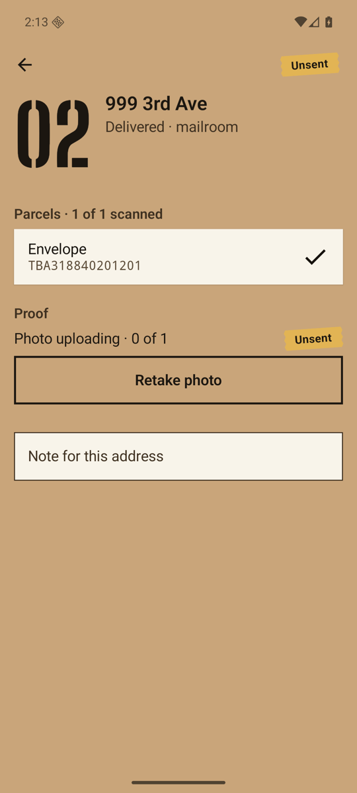
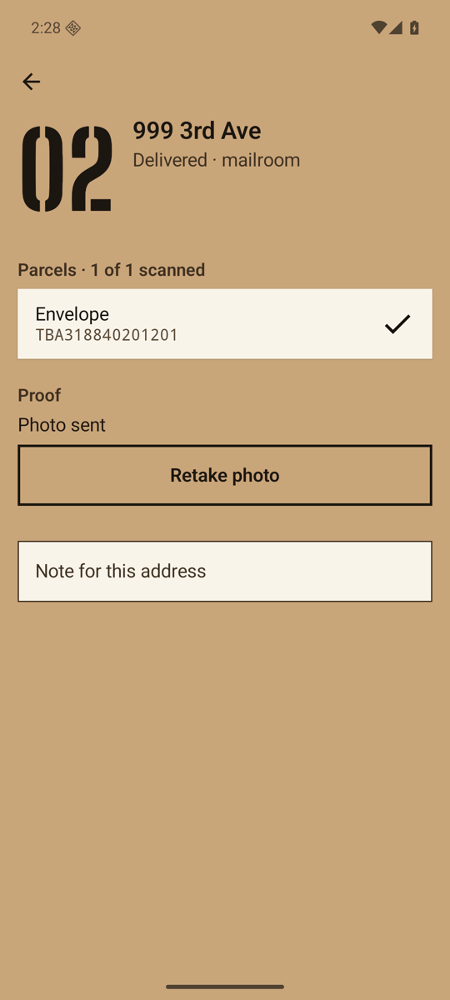
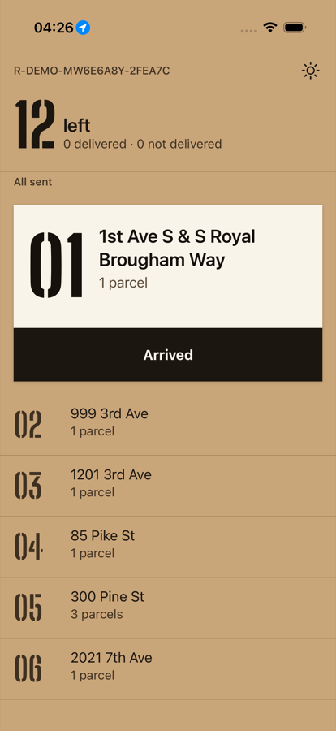
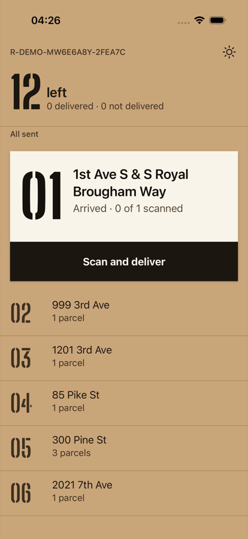

# 05 · Proof of delivery in resumable parts, and knowing when the van has arrived

> The numbers come from `ProofUploadTest`, which runs the real routes, the real `FileBlobStore` and
> the shared uploader over a deliberately lossy HTTP client. The Android captures are from the
> emulator against the local dev server. The SHA-256 values were computed on the phone, by the
> server, and with `shasum` on the stored object, and all three agree.

## The photo takes a different road from the mutation

A proof photo is a 70 KB to 5 MB blob, while a mutation is about 150 bytes of JSON. Putting the
photo in the outbox would make every push carry it, and a lost response would resend it whole.
So the two are split:

```
tap "Take photo"
   │
   ├─ ProofUploader.enqueue(stop, path)       hash the file (okio SHA-256), insert upload_job (SQLite)
   │
   └─ engine.record(AttachProof(stop, uploadId, sha256))      ← ordinary outbox mutation, ~150 bytes
                                                                 rides the normal push/pull (ch. 01–02)
upload loop (own backoff, woken by enqueue / signal / foreground):
   POST   /uploads                {uploadId, stopId, size, sha256}  → {parts: 13, received: [...]}
   PUT    /uploads/{id}/parts/n   256 KiB each, only the ones not received
   POST   /uploads/{id}/complete  server assembles, checks size and SHA-256
```

| design choice | why |
|---|---|
| the phone chooses `uploadId` | a create whose response was lost is just sent again (idempotent, the same rule as `seq` in ch. 02) |
| parts are written to a temp file, then renamed | a request cut off mid-body never leaves half a part that looks complete |
| resume by asking, not by remembering | `received` comes from the server, so a phone that lost its local progress still resends only what is missing |
| SHA-256 checked on `complete` | the server never accepts a photo that differs from what the phone hashed |
| `AttachProof` allowed only on a finished stop | `StopRules` rejects it otherwise (`stop_not_finished`); a retake replaces the reference |
| bytes and reference travel separately | the dispatcher sees "photo pending" as soon as the reference arrives, and the stored bytes are verified against it |

## A 3 MB photo over a bad link

`ProofUploadTest` uploads 3,158,073 bytes (13 parts of 256 KiB) through `testApplication`. The
client drops 15 % of requests before they leave and 15 % of responses after the server has acted.
After every failure the "app is killed": a fresh `ProofUploader` is built on the same SQLite
database. The real run:

```
PROOF-UPLOAD parts=13 partPuts=19 launches=11 droppedRequests=8 droppedResponses=2
```

That is ten restarts and ten lost messages, and only 19 part uploads for 13 parts. Restarting from
byte zero each time would have cost up to 13 × 11. The stored object equals the source byte for
byte (`assertContentEquals`), and its SHA-256 equals the one hashed at capture.

## The same thing on a phone

<p>




</p>

On the emulator, stop 02 is delivered, so a *Proof* section appears. **Take photo** opens the
system camera through a `FileProvider`, and the file lands in the app's private `files/proof/`.
The upload reads "Photo uploading · 0 of 1" with a tape tab, then "Photo sent". The last image
is the same photo fetched by the dispatcher (`GET /v1/dispatch/routes/{r}/proofs/{id}`, 200
`image/jpeg`, 72,842 bytes).

```
phone   upload_job.sha256  7bb64939c84798fa36bb4acbe5798e70c6242a60a343c79e14d759299e226c45
server  stop.proof.sha256  7bb64939c84798fa36bb4acbe5798e70c6242a60a343c79e14d759299e226c45
disk    shasum -a 256      7bb64939c84798fa36bb4acbe5798e70c6242a60a343c79e14d759299e226c45
```

### What went wrong on the way, and why it matters in production

The phone ran the new build against the **old** server for a while. Every push came back
`400 Bad Request` and every upload create came back `404`. The old decoder did not know
`attach_proof`, so the whole batch failed. The outbox, ordered by `seq`, held every later delivery
behind it. Once the new server was running, the queue drained on its own. This is now
[ADR 0005](../adr/0005-protocol-evolution.md): deploy the server first, and treat a new mutation
type as a breaking change.

## Arrival, from GPS that lies

`ArrivalDetector` (`shared/model`) decides when the van is at the next stop. It uses three rules,
each pinned by a test:

| rule | why | test |
|---|---|---|
| arrival needs 20 s inside 40 m | one fix inside the circle is noise between glass towers | `arrivesOnlyAfterDwellingInsideTheRadius` |
| fixes worse than 50 m accuracy are ignored | a 120 m fix can't prove anything about a front door | `vagueFixesAreIgnored` |
| leaving needs 80 m (hysteresis) | a fix bouncing between 30 and 70 m must not toggle arrival on and off | `jitterAcrossTheEdgeDoesNotFlapAfterArrival` |
| driving past at 15 m/s is not arrival | the street passes 20 m from the door, but the van never dwells | `drivingPastDoesNotCountAsArrival` |

It is pure, deterministic Kotlin, so the same detector runs on both phones and is tested on JVM,
Android and iOS.

### Wired to the phone's location

```
Android  LocationManager (fused on API 31+, GPS before), every 5 s ┐
iOS      CLLocationUpdate.liveUpdates(.automotiveNavigation)       ├─▶ RouteScreenModel.onLocation(fix)
                                                                    │        target = next PLANNED stop
both     5 s clock while location is on ───────────────────────────┴─▶ RouteScreenModel.onLocationTick(now)
                                                                             │ Arrived
                                                                             ▼
                                                     engine.record(Arrive(stop, at = decision time))
                                                     the same mutation as the driver's tap, so it goes
                                                     through StopRules, the outbox and the push as usual
```

Both apps ask only for **while-in-use** permission. The route is on screen while the driver
drives, so "always" location is not worth asking for. If the driver says no, the Arrived button
still works as before.

### What the first end-to-end run caught

`ArrivalUITests` launches the iOS app with the simulator at the Space Needle, taps *Allow While
Using App*, and then moves the device to stop 01 (47.5917, −122.3343). The first run failed with
"never arrived". Logging every update showed why:

```
04:37:11.234 milkrun loc Optional(47.6205) stationary=0     ← at the Space Needle
04:37:23.030 milkrun loc Optional(47.5917) stationary=0     ← moved to stop 01 … and then nothing
```

When a device stops moving, Core Location stops sending updates, and a fused provider does the
same. Parking looks exactly like this. The detector only decided on the next fix, so the 20 s
dwell never completed. The unit tests had not caught it, because the synthetic tracks sent a fix
every second. The fix is `ArrivalDetector.onTick(now)`. After a good fix inside the radius,
silence counts as staying put, and any movement brings a new fix that can reset the dwell. Both
apps call it every 5 s. Two tests pin it: `aParkedPhoneThatStopsReportingStillArrivesOnTheClock`
and `aTickDoesNotArriveAfterTheLastFixWasOutside`.

Second run: **arrived 22 s after reaching the stop** (20 s dwell, plus up to one 5 s tick), with
no tap:

| at the Space Needle | parked at stop 01, 22 s later |
|---|---|
|  |  |

The server received it as an ordinary push:

```
04:41:15.631 INFO [4a50686a921f3e048ce7fa80c34b8b4b] [2426b77d-…] 200 OK: POST - /v1/routes/R-DEMO-MW6E6A8Y-2FEA7C/push in 46ms
```
